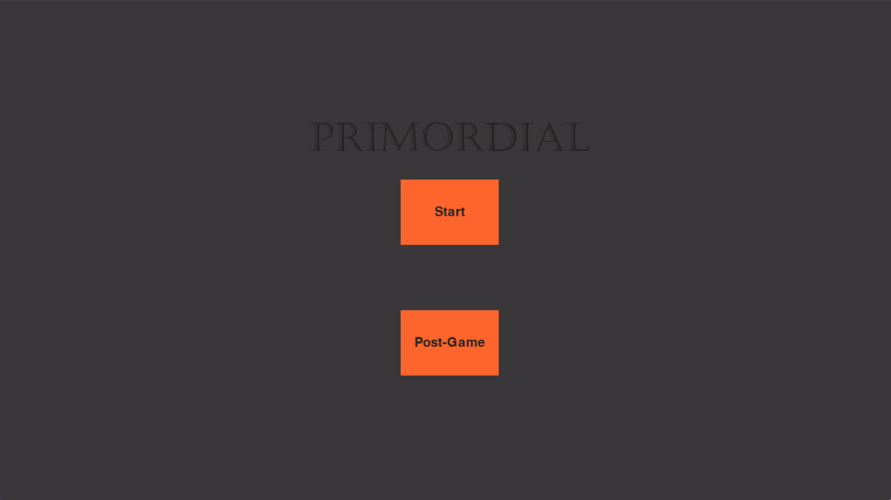
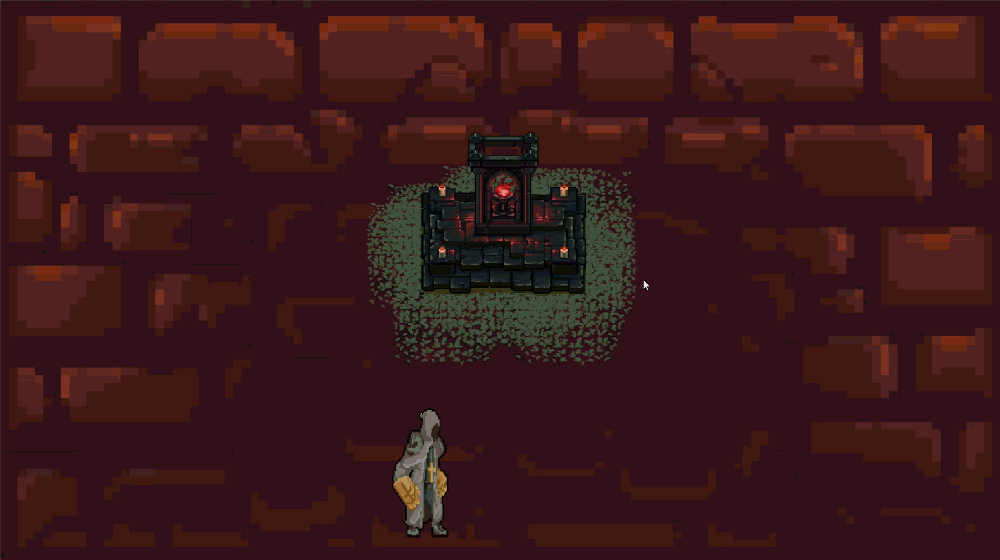
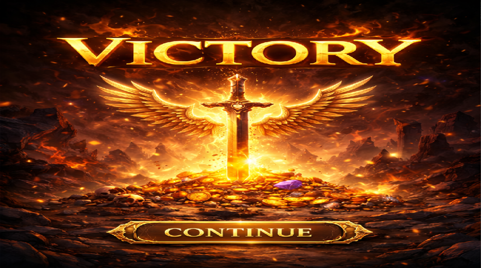
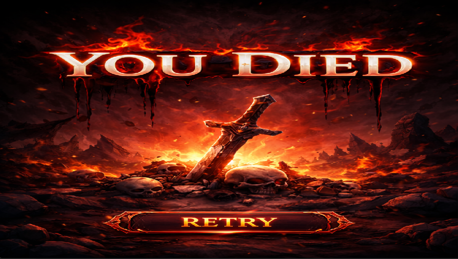

# Primordial

A fast-paced 2D boss fight game built using Python's pygame library.

## Key Features
* **Collision handling:** implemented collision handling by manipulating pygame surfaces to allow boss and player to damage one another.
* **Image rendering:** used surfaces in pygame to create animated sprites for the player, boss and more.
* **Time-based logic:** frame-related calculations to implement boss's exhaustion phase, during which player can attack, as well as player and boss invincibility frames.
* **State management:** made use of OOP to create classes for different game states allowing for seamless transitions between the main-menu, main-game and victory/death screens.

## Screenshots
| Main Menu |
| :---: |
||

| Altar |
| :---: |
||

| Boss's Exhaustion |
| :---: |
||

| Victory Screen |
| :---: |
||

| Death Screen |
| :---: |
||

## Project Reflection
### Technical challenges:
* **Player animation disruption:** Initially, the player's attack animation was interrupted if the player was also walking, I resolved this by using Boolean state variables for the animation classes to handle interrupts.
* **Instant player death:** After implementing a player life system, the player would instantly die when the player surface collided with an attack surface, I was able to resolve this by incorporating time-based logic to establish invincibility frames for the player.
* **Lingering attacks:** Used pygame's sprite class's empty() method to dispose of lingering attack sprites that would damage the player at the start of a new attempt.
### Future implementations:
* **FPS improvements:** As it stands, the game suffers from large frame drops due to consistent instantiation of new images, which is how I approached animating sprites. In reflection, object pooling would have been a more optimised approach.
*  **Further development** Currently, there is a post-game menu accessible from the main menu, however I am yet to implement a post-game.

## How to run
1. Clone the repository: `git clone https://github.com/declan-08/primordial.git`
2. Install pygame: `pip install pygame`
3. Run the game: `Primordial.py`
