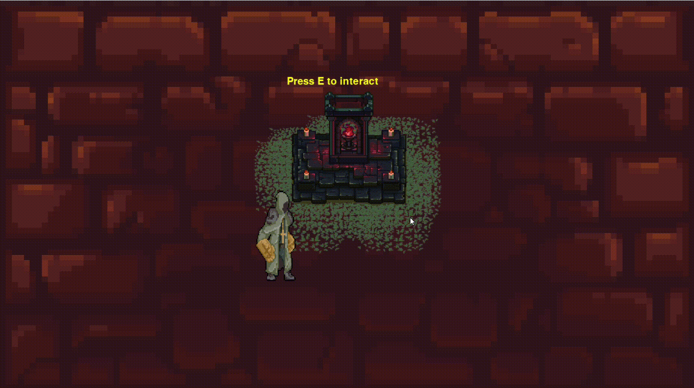
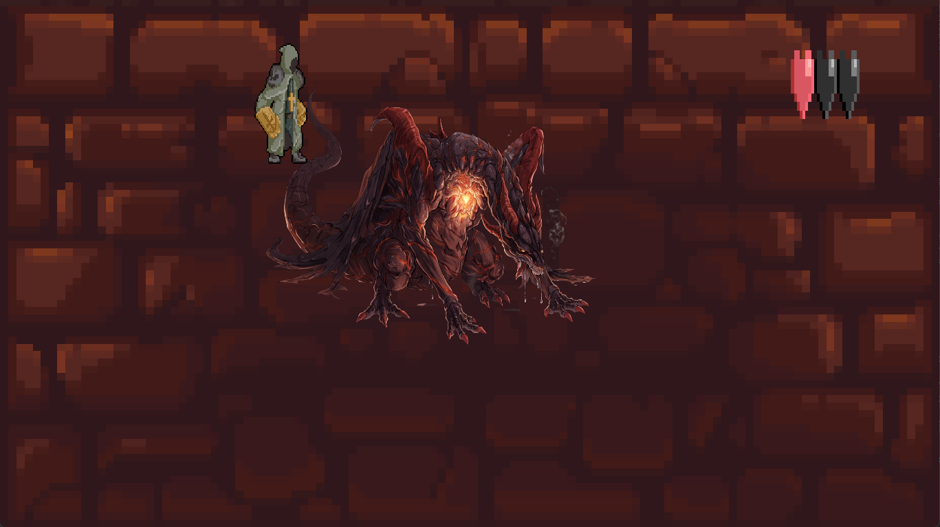

# Primordial

A fast-paced 2D boss fight game built using Python's pygame library.

## Key Features
* **Collision handling:** implemented collision handling by manipulating pygame surfaces to allow boss and player to damage one another.
* **Image rendering:** used surfaces in pygame to create animated sprites for the player, boss and more.
* **Time-based logic:** frame-related calculations to implement boss's exhaustion phase, as well as player and boss invincibility frames.
* **State management:** made use of OOP to create classes for different game states allowing for seamless transitions between the main-menu, main-game and victory/death screens.

## Screenshots
| Main Menu |
| :---: |
||

| Boss's Exhaustion |
| :---: |
||
